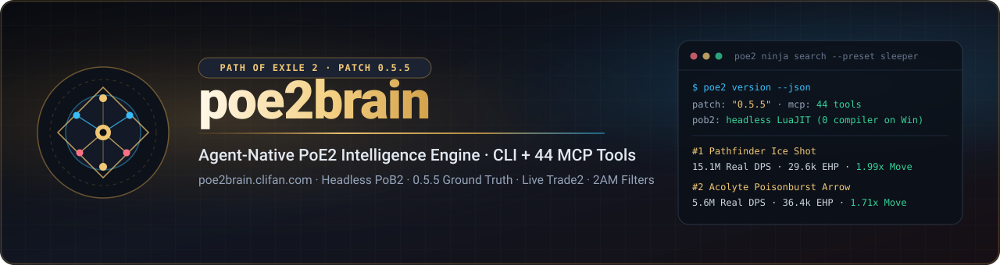
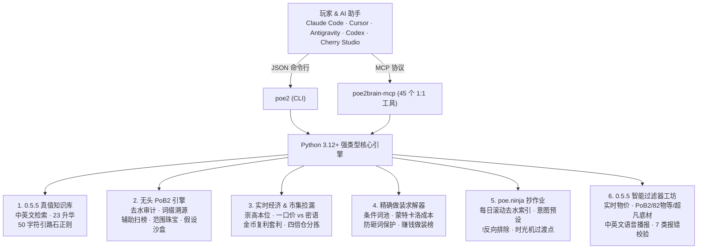

<div align="center">



<br/>

[](https://github.com/lifan-builds/poe2brain/actions/workflows/ci.yml)
[](#准确率实测接入-poe2brain-前后对比)
[](https://github.com/lifan-builds/poe2brain)
[](#完整工具与命令速查)
[](#windows--macos-3-分钟上手)
[](LICENSE)

<h3>
  给 Claude Code、Cursor、Antigravity、Codex、Cherry Studio 装上<br/>
  真正的《流放之路 2》(<code>0.5.5</code>) 本地 PoB2 与市集大脑 —— 拒绝 AI 幻觉，绝不碰 <code>POESESSID</code>。
</h3>

<p>
  <a href="README.md">English</a> ·
  <a href="README_ZH.md"><strong>简体中文</strong></a> ·
  <a href="docs/zh/CN_FREE_SETUP.md"><strong>国内免代理一键装 &amp; 零 JSON 接入</strong></a> ·
  <a href="docs/zh/QUICKSTART_WINDOWS.md"><strong>Windows 零编译保姆教程</strong></a> ·
  <a href="docs/zh/AGENT_SETUP.md"><strong>AI 客户端接入 &amp; 提示词</strong></a> ·
  <a href="docs/zh/PLAYBOOKS.md"><strong>六大实战工作流手册</strong></a>
</p>

</div>

> **灵感致谢：** 特别感谢 UP 主 **[流放降临-某雷](https://space.bilibili.com/2132384)** 与他的流放 1 开源项目 [`exilemoulei/pob4agents`](https://github.com/exilemoulei/pob4agents) 把「PoE 接 AI 助手」这条路趟了出来！`poe2brain` 是受其启发、专为 **《流放之路 2》（`Patch 0.5.5`）** 从零独立编写的姊妹引擎；玩一代的兄弟强烈推荐去支持雷哥的 [`pob4agents`](https://github.com/exilemoulei/pob4agents)！

---

## 为什么做 `poe2brain`？（告别 AI 拿流放 1 规则胡说八道）

直接拿通用大模型问《流放之路 2》配装、做装或市集捡漏，90% 会翻车：AI 会用流放 1 的老黄历告诉你「75% 格挡上限」「改造石洗词缀」「用工艺台」「用 0.4 就删掉的同质化预兆」，甚至把 PoB 战神勾选的虚高面板当成真实伤害。

**`poe2brain`** 是一套 **完全免费开源、跨平台（Windows 零编译）** 的 PoE2 专属智能引擎：同一套核心同时提供 **命令行 (`poe2`)** 与 **MCP Server (`poe2brain-mcp`，45 个 1:1 工具)**，把本地后台真跑的 **Path of Building 2**、Patch `0.5.5` 离线真值数据库、实时市集一口价捡漏、做装期望求解器和防崩过滤器工坊直接交给你的 AI 助手。

| 玩家 / AI 常见痛点 | 直接问普通 AI / 手工查表 | 用 `poe2brain` (`Patch 0.5.5`) |
| :--- | :--- | :--- |
| **拿流放 1 规则套流放 2** | 瞎编 75% 格挡、工艺台、已删除通货 | **离线 SQLite + FTS5 真值库**：769 条官方弹窗、54 条防幻觉铁律、23 升华，**支持中文直接搜** |
| **抄到「PoB 战神」水货 BD** | 只看勾满药剂/满感电的虚假面板 | **本地后台真跑 PoB2**：一键**去水审计 (`pob audit`)**（含怒火锤炼/召唤契约等条件辅助与虚高攻速预警）+ 前 5 项配装瓶颈 |
| **想找冷门高伤高速黑马 BD** | 榜一全是天价镜子装或烂大街 Meta | **每日自动去水更新的实时 BD 索引**（GitHub Actions 滚动发布 + 本地 SQLite 缓存）：一句 `--preset sleeper` 1 秒算出真实 DPS × 移速 × 稀有度黑马榜 |
| **市集被密语压价号钓鱼** | 最低价全是 1 崇高不卖人的脚本号 | 自动拆分 **金币一口价 (`securable`，离线秒买)** vs **密语 (`whisper`)**，自动补满 20% 品质与符文再跑分 |
| **做装靠感觉容易血本无归** | 不懂 0.5.5 阶梯通货等级下限与词池互斥 | **精确条件词池 MDP + 蒙特卡洛 (`p50`/`p80`/`p95`)**，直接算出「自己做 vs 市集买」谁更赚 |
| **过滤器漏底材或进游戏直接报错** | `MapTier` / `Expert` 基底写错崩溃，或漏掉 82 物等/超凡工艺底材 | **7 类崩溃自校验编译器 + NeverSink 自动修复**：实时物价分层、绑定 PoB2 抓 82 物等/超凡底材、中英文语音播报 |
| **担心封号 / Windows 装不上** | 要抠 `POESESSID` Cookie，或在 Windows 折腾 C 编译器 | **零 `POESESSID`、零读内存、零自动交易**（支持本地 PoB2 导入与官方 GGG OAuth 2.1）；**Windows 零编译开箱即用** |

---

## 准确率实测：接入 `poe2brain` 前后对比

我们构建了开源可复现的 **22 题 / 75 项核验** 离线基准测试 **[`PoE2Bench-0.5.5`](benchmarks/README.md)**，覆盖全部六大模块（0.5.5 核心机制、中英文升华与国服剪贴板、做装条件词池精算、异界与 50 字符引路石正则、无头 PoB2 去水/合法 6 连换辅助/HC 审计/符文配平/假设沙盒、过滤器崩溃校验）。两组测试使用**完全相同的旗舰模型（`gpt-6.2-astra`）**、均关闭联网搜索，并向无工具基线组完整提供解码后的明文 PoB2 `.xml`、`.filter` 与剪贴板样本文件：

| 评测指标（同模型 `gpt-6.2-astra`，零联网搜索） | 未接入 `poe2brain` | 接入 `poe2brain` | 提升幅度 |
| :--- | :---: | :---: | :---: |
| **整题完全通过率（Exact Pass）** | 6 / 22 (`27.3%`) | **22 / 22 (`100.0%`)** | **+72.7 pp（提升 `3.7×`）** |
| **分项事实准确率（Sub-Checks）** | 38 / 75 (`50.7%`) | **75 / 75 (`100.0%`)** | **+49.3 pp** |
| **流放 1 / 旧版本幻觉率** | 4 / 22 (`18.2%`) | **0 / 22 (`0.0%`)** | **幻觉清零** |

### 典型实测题目对比（未接入 vs 接入 `poe2brain`）

| 题号 | 真实玩家问题（Patch `0.5.5`） | 未接入 `poe2brain` | 接入 `poe2brain` |
| :--- | :--- | :--- | :--- |
| **Q02** | 被动格挡基础上限、`Glancing Blows`（扫荡打击）效果，以及敏捷装偏斜（Deflection）减伤比例与上限？ | ❌ 幻觉出流放 1 的 `75%` 格挡上限与旧规则 | ✅ **`50%` 格挡上限**、**闪避不幸 / 偏斜幸运**、偏斜 **`40%` 减伤 / `95%` 上限** |
| **Q09** | `82` 物等稀有 `Warmonger Bow` 裸点高阶崇高 vs 完美崇高出 T1 `% 物理伤害`（权重 25）的精确概率与期望次数？ | ❌ 无法计算 0.5.5 词池总权重，只能给符号公式 | ✅ **精确词池精算：**高阶 `40,482`（`0.0618%`，`1,619.3` 次）vs 完美 `24,782`（`0.1009%`，`991.3` 次，`1.634×`） |
| **Q10** | `0/2/4/6` 词缀引路石复活次数、碑牌放哪、0.5 三位异界大师叫什么，以及 0.5.5 `Sacred Blooms` 生成什么？ | ❌ 把 0 词缀复活误说成 `6` 次，且答不出三位异界大师与 Sacred Blooms | ✅ **`5/4/2/0` 次复活**、碑牌直插地图仪、**`Jado / Hilda / Doryani`**（同启 1 位）、生成**翠绿荒林 / 灵体** |
| **Q12** | 为 CI 能量护盾 BD 编译一条 `<=50` 字符的 PoE2 仓库排除正则（避开全部 6 条致命词缀） | ❌ 把 `!` 写进引号内（`"!m player r\|..."`），游戏内失效 | ✅ **`!"buil\|ever\|of l\|pene\|weak\|player r"`**（**36 字符**，6/6 致命词缀 `0` 漏报、`0` 误伤） |
| **Q17** | 针对已插满 5/5 辅助的亚马逊冰箭 BD，在**去水攻坚配置**下找出最弱辅助并给出合法 6 连最优替换 + 验证智力需求 | ❌ 无法算出最弱辅助、合法替换 DPS 或重算后的智力需求 | ✅ 自动替换最弱 #4 **`Stoicism II`** → **`Hit and Run`**（`121,674 → 170,344`，**`+40.0%`**）；#2 `Elemental Focus`（`+23.98%`，满足属性需求） |
| **Q19** | 跑离线符文/魂核配平：保留锁孔镶嵌物（Socket-bound），计算补混沌抗所需魂核数与真实换符文后的净 DPS/EHP 变化 | ❌ 套用过时的 `+7%` 塔卡蒂数值（浪费 7 颗而非 3 颗），算不出真实换装净变化 | ✅ 自动锁住 **`Kolr's Hunt`**（`11/12` 可覆盖孔），**3 颗 `Soul Core of Tacati`**（`21% → 60%` 混抗），实测净变化 **`-43,108 DPS / +2,017 EHP`**，离线成本 `null` |
| **Q22** | `what-if` 仅关掉 `multiplierRage=0` 的精确掉伤比例 + 严格离线四倍仓分拣（`--no-live-trade`） | ❌ 心算硬除 `1.30`（算成 `-23.1%`，因漏算狂战/怒气效果误差近 9.5 个百分点） | ✅ 精确算出 **`237,993 → 160,418 (-32.6%)`**；离线分拣：`82` 级白法杖 `3P/3S` 空词缀，低Roll 戒指归入 `salvage_or_vendor` |

> 完整 22 题明细、分模块通过率、原始对话存档（[`benchmarks/results/codex_0_5_5.json`](benchmarks/results/codex_0_5_5.json)）与一键复现命令详见 **[`benchmarks/README.md`](benchmarks/README.md)**：
> ```bash
> uv run python benchmarks/run_benchmark.py score benchmarks/results/codex_0_5_5.json
> ```

---

## 实测效果一览

### 1. 一句话挖出「冷门 + 高真实伤害 + 高移速」黑马 BD

```bash
uv run poe2 ninja search --preset sleeper --limit 5
```

```text
     poe.ninja Builds — Forbidden Rites (matched 59/345 | preset=sleeper | sort=sleeper)
┏━━━━━━━━━━━━━━━━━━┳━━━━━━━━━━━━━━━━━━━━┳━━━━━┳━━━━━━━━━━━━━━━━━━━┳━━━━━━━━━━━━┳━━━━━━━━┳━━━━━━━┓
┃ Character        ┃ Ascendancy         ┃  Lv ┃ Main Skill        ┃        DPS ┃    EHP ┃  Move ┃
┡━━━━━━━━━━━━━━━━━━╇━━━━━━━━━━━━━━━━━━━━╇━━━━━╇━━━━━━━━━━━━━━━━━━━╇━━━━━━━━━━━━╇━━━━━━━━╇━━━━━━━┩
│ popyj            │ Pathfinder         │ 100 │ Ice Shot          │ 15,150,400 │ 29,631 │ 1.99x │
│ 一阿克一         │ Pathfinder         │  99 │ Ice Shot          │ 15,093,062 │ 23,467 │ 2.04x │
│ Noxious_Fu...    │ Acolyte of Chayula │ 100 │ Poisonburst Arrow │  5,652,710 │ 36,369 │ 1.71x │
│ EightChall...    │ Shaman             │ 100 │ Spark             │  7,113,825 │ 24,586 │ 1.98x │
│ 风枪锐眼         │ Pathfinder         │ 100 │ Ice Shot          │  3,979,867 │ 21,084 │ 2.17x │
└──────────────────┴────────────────────┴─────┴───────────────────┴────────────┴────────┴───────┘
```

### 2. 像和老玩家聊天一样直接问 AI（接入 MCP 后直接复制使用）

- **找黑马 BD：** *「帮我找当前赛季冷门、不要永恒时刻（Temporalis）、真实去水 DPS 高且移速快的 3 套黑马 BD，并找出它们前期最省钱的时光机过渡快照。」*
- **给自己的号体检：** *「导入我本地 PoB2 里最新保存的 BD，跑一次去水审计告诉我最大瓶颈是什么，再在 50 崇高以内搜市集金币一口价能买到的最大武器提升。」*
- **四倍仓一键分拣：** *「我把刚才刷图打的一堆装备 `Ctrl+C` 贴给你，按 5 崇高为界帮我分成立即秒卖、半成品值得做、赌鉴定揭秘、直接分解四堆。」*
- **做装前先算账：** *「我想做一把 82 级法杖要 T1 法伤 + 法术技能等级，帮我算期望成本和 p80 脸黑成本，对比市集直接买划算还是自己做划算。」*
- **防翻车刷图 + 智能语音过滤器：** *「根据我当前槽位 BD 生成一条 50 字符以内的防翻车异界引路石正则，再帮我生成一套暗黑金色、抓 82 物等/超凡底材、带中文大货语音播报的严格过滤器。」*

> 更多中文对话模板请见：[docs/zh/AGENT_SETUP.md](docs/zh/AGENT_SETUP.md)

---

## 核心架构（六大模块）



---

## Windows / macOS 3 分钟上手

> **国内直连卡顿 / 没有付费 Claude？** 见 **[国内免代理一键装 &amp; Cherry Studio / Trae + DeepSeek 零 JSON 接入指南](docs/zh/CN_FREE_SETUP.md)**：自带阿里云/南京大学镜像脚本 `scripts/install_cn.ps1`、`poe2 setup-mcp --profile core`（精简 17 工具适配国产模型）、`poe2 doctor` 自检、`poe2 update --cn`（1.0 一键更新）与 `poe2 uninstall` 一键卸载。
>
> **不会命令行？最省心的方法（推荐）：** 直接把下面这句话发给你的 AI 编程/桌面客户端（**Claude Code / Cursor / Codex / Antigravity / Trae**），让 AI 全自动帮你装好：
>
> > *「请帮我克隆 `https://github.com/lifan-builds/poe2brain`，按照里面的 `docs/zh/QUICKSTART_WINDOWS.md` 帮我装好 `uv`、执行 `uv sync`、`uv run poe2 bootstrap pob2`，验证 `uv run poe2 version --json` 通过后帮我接好 MCP。」*
>
> 完整 Windows 保姆级避坑文档（含 **`Failed to spawn: poe2` 排查**、PowerShell 中文乱码、本地 PoB2 自动识别）：[docs/zh/QUICKSTART_WINDOWS.md](docs/zh/QUICKSTART_WINDOWS.md)
>
> **可选网页试用：** 另有轻量网页版 [poe2brain.clifan.com](https://poe2brain.clifan.com/)（部署在海外节点，国内网络可能无法直连；完整无头 PoB2、本地存档与 MCP 接入推荐使用下方本地安装）。

### 第 1 步：安装 `uv`（极速 Python 环境管理器）

- **Windows (PowerShell):**
  ```powershell
  powershell -ExecutionPolicy ByPass -c "irm https://astral.sh/uv/install.ps1 | iex"
  ```
- **macOS / Linux:**
  ```bash
  curl -LsSf https://astral.sh/uv/install.sh | sh
  ```

### 第 2 步：下载并初始化 `poe2brain`

```bash
git clone https://github.com/lifan-builds/poe2brain.git
cd poe2brain
uv sync

# 初始化无头 PoB2 引擎
# • Windows：无需安装 Visual Studio / C 编译器！自动复用本地 PoB2 或拉取 MIT x64 lua51.dll
# • macOS / Linux：自动编译 LuaJIT 2.1 + luautf8
uv run poe2 bootstrap pob2

# 检查一切就绪
uv run poe2 version --json
```

### 第 3 步：导入你的角色（开荒第 1 天即用，绝不碰 `POESESSID`）

- **方式 A：零登录读取本地 PoB2 存档（最推荐，开箱即用）**
  ```bash
  uv run poe2 pob import-local --list
  uv run poe2 pob import-local --slot main
  ```
- **方式 B：官方 GGG OAuth 2.1 PKCE 登录（与 PoB2 相同的官方授权流程）**
  ```bash
  uv run poe2 auth login
  uv run poe2 pob import-character --list
  uv run poe2 pob import-character "你的角色名" --slot main
  ```
- **方式 C：直接导入 `poe.ninja` / `poe2db` / `maxroll` / `pobb.in` 链接或 `eN...` 分享码**
  ```bash
  uv run poe2 ninja character "https://poe.ninja/poe2/builds/..." --load-pob --slot main
  uv run poe2 pob load "eN..." --slot main
  ```

---

## 接入主流 AI 助手

仓库已自带主流 AI 客户端配置，详细图文步骤见 **[docs/zh/AGENT_SETUP.md](docs/zh/AGENT_SETUP.md)**：

- **Claude Code / Cursor：** 直接在项目目录打开（自动识别 [.mcp.json](.mcp.json)），或全局粘贴下方配置。
- **Antigravity：** 内置插件清单 [plugin.json](plugin.json) 与技能说明 [.agents/skills/poe2brain/SKILL.md](.agents/skills/poe2brain/SKILL.md)。
- **Cherry Studio / Cline / 通用 MCP 客户端：**

```json
{
  "mcpServers": {
    "poe2brain": {
      "command": "uv",
      "args": ["--directory", "C:/你的路径/poe2brain", "run", "poe2brain-mcp"]
    }
  }
}
```

---

## 常用玩法速查

> 六大模块的深入实战手册见：[docs/zh/PLAYBOOKS.md](docs/zh/PLAYBOOKS.md)

```bash
# 1. 中文查升华 / 机制 / 宝石（彻底告别 PoE1 幻觉）
uv run poe2 wiki ascendancy "风暴编织者"
uv run poe2 wiki mechanic "能量护盾"
uv run poe2 wiki gem "拉基亚塔的流光"

# 2. 一键挖冷门高伤高速黑马 BD，或用 ! 排除不想看的升华/传奇
uv run poe2 ninja search --preset sleeper --limit 5
uv run poe2 ninja search --ascendancy "!Gemling Legionnaire,!Deadeye" --unique "!Temporalis"

# 3. 去水审计（含瓶颈诊断）+ 词缀溯源 + 辅助宝石扫榜 + 可控蜕变选孔
uv run poe2 pob audit --slot main
uv run poe2 pob calc-breakdown EnergyShield --slot main
uv run poe2 pob supports --slot main --max-tier 2 --no-lineage
uv run poe2 pob radius-jewels --jewel "Controlled Metamorphosis" --slot main

# 4. 市集 50E 一口价自动捡漏（自动模拟补满 20% 品质 + 高级符文再算提升）
uv run poe2 trade upgrades --equip-slot "Weapon 1" --max-exalted 50 --securable-only --slot main

# 5. 藏身处套利扫描（统一 --budget 支持 500 崇高或 5d 神圣）& 赚钱做装榜
uv run poe2 econ arbitrage --budget 5d --gold 50000
uv run poe2 craft profit --budget mid

# 6. 生成 <=50 字符防翻车引路石正则 & 绑定 PoB2 + 中文语音播报的 0.5.5 严格过滤器
uv run poe2 wiki regex --slot main
uv run poe2 filter generate --slot main --strictness strict \
  --look "暗黑金色 中文语音播报" --out my_build.filter --install
```

---

## 完整工具与命令速查

<details>
<summary><strong>点击展开：全部 45 个 MCP 工具与 CLI 命令一览</strong></summary>

| 模块 | 代表 MCP 工具 | 对应 CLI 命令 | 核心用途 |
| :--- | :--- | :--- | :--- |
| **状态** | `poe2_status` | `poe2 version --json` | 检查补丁 (`0.5.5`)、数据库与无头 PoB2 就绪状态 |
| **知识库 (9)** | `poe2_search_knowledge`, `poe2_explain_mechanic`, `poe2_inspect_gem/base/unique/augment/ascendancy`, `poe2_meta_ladder`, `poe2_waystone_regex` | `poe2 wiki search/mechanic/gem/base/unique/augment/ascendancy/meta/regex` | 中英文真值检索、23 升华、全服 Meta、50 字符防翻车引路石/碑牌正则 |
| **无头 PoB2 (15)** | `poe2_pob_load/stats/audit/compare/hc_audit/eval_item/stat_weights/suggest_nodes/optimize_runes/calc_breakdown/supports/radius_jewels/what_if/import_local/import_character` | `poe2 pob load/stats/audit/compare/hc-audit/eval-item/weights/nodes/runes/calc-breakdown/supports/radius-jewels/what-if/import-local/import-character` | 多槽位 PoB2 计算、去水体检与瓶颈/IIR 定位、HC 猝死审计、词缀溯源、符文/辅助/范围珠宝排榜、无损假设沙盒 |
| **经济搬砖 (5)** | `poe2_currency_price`, `poe2_market_scan`, `poe2_boss_ev`, `poe2_farming_strategy`, `poe2_scan_arbitrage` | `poe2 econ price/scan/bosses/farming/arbitrage` | 崇高本位实时物价、赛季初/终局异界搬砖与大师策略、门票收益比、金币税感知套利与复利阶梯 |
| **市集估价 (4)** | `poe2_parse_item`, `poe2_price_check`, `poe2_triage_dump`, `poe2_find_upgrades` | `poe2 trade parse/check/triage/upgrades` | 中英文 `Ctrl+C` 解析、一口价 vs 密语估价、四倍仓分拣、PoB2 真实提升捡漏 |
| **做装求解 (3)** | `poe2_craft_odds`, `poe2_craft_plan`, `poe2_scan_craft_profit` | `poe2 craft odds/plan/profit` | 精确条件词池概率、防砸词保护、期望与 p80 脸黑成本、高利润低竞争做装榜 |
| **poe.ninja (3)** | `poe2_ninja_snapshots`, `poe2_ninja_search`, `poe2_ninja_character` | `poe2 ninja snapshots/search/character` | 全服快照、`--preset` 黑马/开荒/速刷检索、`!反向过滤`、时光机低预算过渡点探测 |
| **过滤器工坊 (5)** | `poe2_filter_presets`, `poe2_filter_generate`, `poe2_filter_restyle`, `poe2_filter_validate`, `poe2_filter_heal` | `poe2 filter presets/generate/restyle/validate/heal` | 实时物价分层、PoB2/82物等/超凡底材、中英文语音播报、NeverSink 自动修复、7 类报错校验（含可选色盲/夜间模式） |

</details>

---

## 国服（腾讯服）vs 国际服 & 1.0 更新计划

| 功能模块 | 国际服 | 国服（腾讯服） | 说明 |
| :--- | :---: | :---: | :--- |
| **本地 PoB2 算伤 / 去水审计 / 切武器检查 / 符文选配** | ✅ | ✅ | 纯本地离线计算，直接读电脑里的 PoB2 存档 |
| **0.5.5 中英文机制真值库 & 引路石/圣物/碑牌正则** | ✅ | ✅ | 内置中文检索，≤50 字符搜索正则直接粘进仓库 |
| **国服中文剪贴板解析（含带空格 `稀 有 度:`）** | ✅ | ✅ | 支持直接 `Ctrl+C` 复制国服装备做解析与词缀评估 |
| **0.5.5 智能过滤器、语音播报 & 老过滤器修复** | ✅ | ✅ | 本地生成/校验 `.filter`（抓 82 物等/超凡底材），进游戏零报错 |
| **精确做装词池概率 & 防砸词规划 (`craft odds/plan`)** | ✅ | ✅ | 离线概率与步骤计算；自定义通货汇率即可算国服成本 |
| **实时市集一口价捡漏 & `poe.ninja` 榜单** | ✅ | ⏳ 评估中 | 目前接入国际服公开只读接口；国服实时物价后续视零 Cookie 合规接口可行性持续跟进 |

- **1.0 正式版跟进计划：** 离线数据库构建管线与无头 PoB2 引擎均为自动化更新结构；1.0 解包数据与 PoB2 天赋树发布后会第一时间同步升级。
- **近期路线图：** 多点天赋树路径自动优化（目前支持单点/短路径推荐与可控蜕变/妄想症选孔）、按赛季实时物价自动刷新过滤器分级。

---

## 合规边界与开源声明

- **严格遵守 GGG 服务条款（绝不触碰封号红线）：** 本项目仅作为**局外离线计算、剪贴板解析与公开 API 顾问**运行。绝不读取或存储 `POESESSID` / 登录 Cookie，绝不读取游戏内存或截屏 OCR，绝不向游戏客户端注入任何键鼠点击或自动密语交易，所有公开市集请求均经过动态限流器 (`GGGRateLimiter`)。
- **完全免费开源 (`GPL-3.0-only` + 第 7 条署名条款)：** 代码依据 [LICENSE](LICENSE) 与 [ATTRIBUTION.md](ATTRIBUTION.md) 开源；欢迎与其他 `GPL-3.0` 开源项目复用或集成，衍生版本须保持 `GPL-3.0` 开源、不得使用 `poe2brain` 名称，并在 README / 致谢文档（独立分支还需在 `--version` / 关于输出）中保留署名：
  > Based on poe2brain by lifan-builds (https://github.com/lifan-builds/poe2brain)
- **合规上游致谢：** `data/` 离线查表数据与无头计算内核均源自宽松 MIT 开源项目（`PathOfBuildingCommunity/PathOfBuilding-PoE2`、`Exiled-Exchange-2`、`ackness/pobr`、`repoe-fork/poe2`、`NeverSink-Filter-for-PoE2`），并完整保留原 MIT 许可声明。
- 欢迎通过 [CONTRIBUTING.md](CONTRIBUTING.md) 提交 PR（首次提交签署一次性 [CLA](CLA.md)）；商业/非 GPL 授权请联系 `lifan-builds` 开 Issue 咨询。
